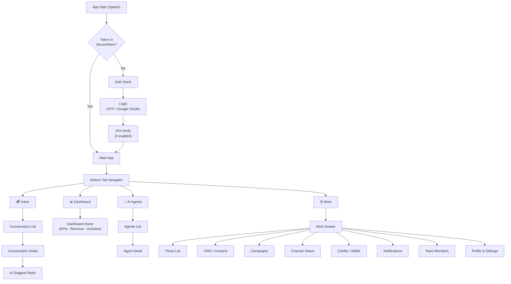
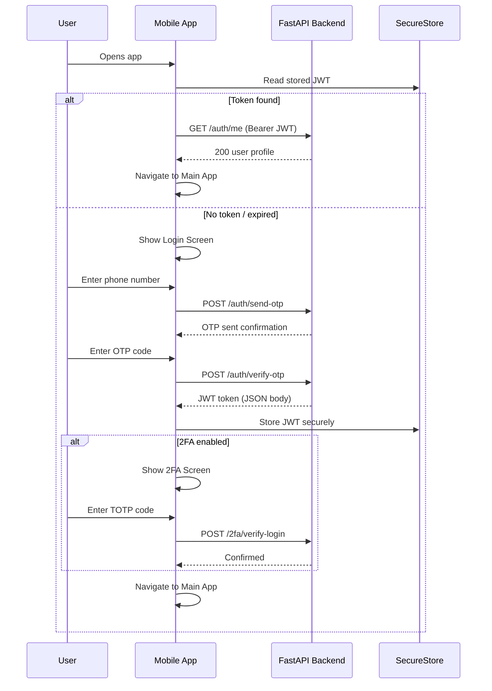
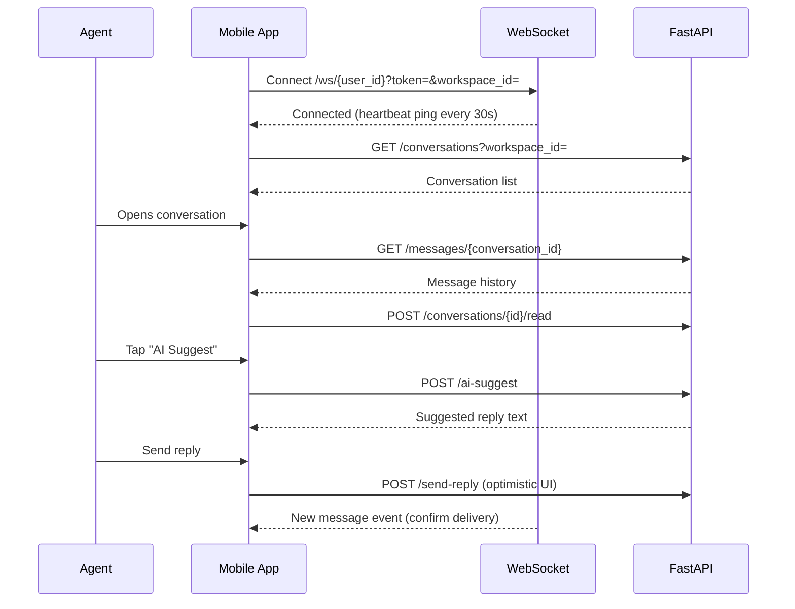
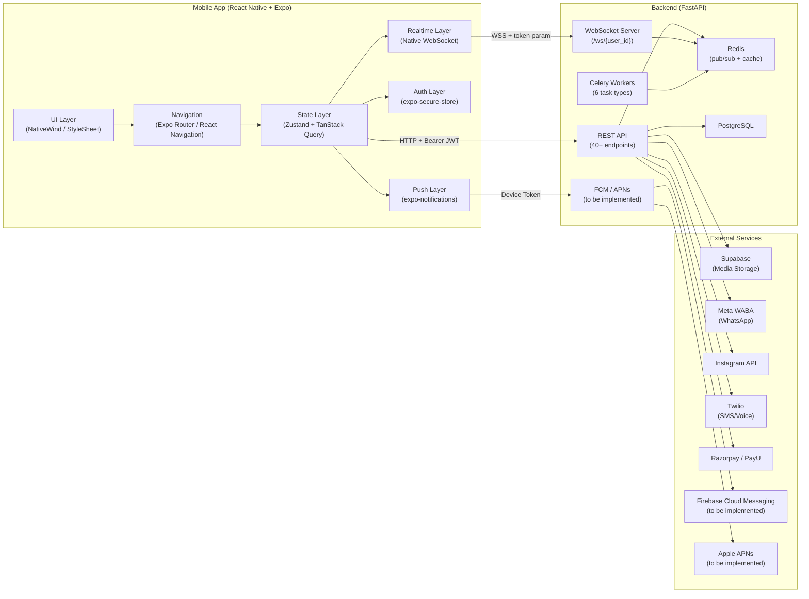
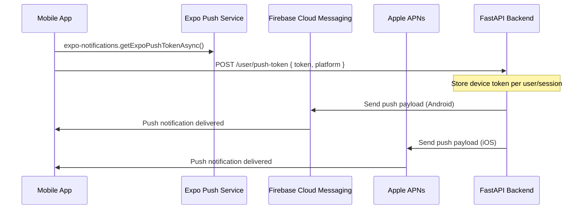
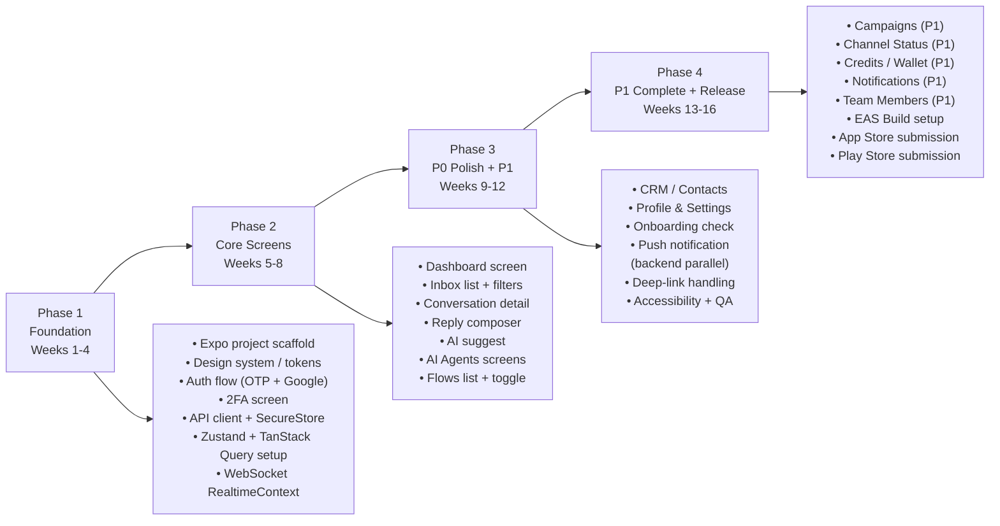
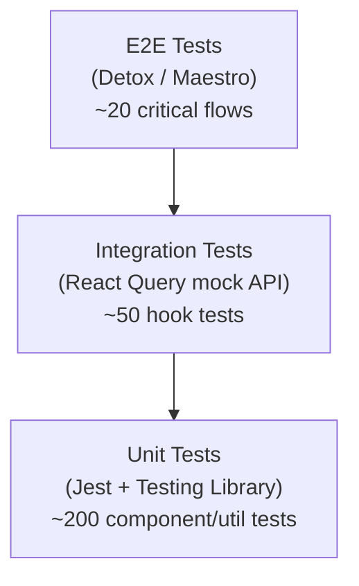

# Orbion Agents — Mobile App Architecture Report

**Document Version:** 1.0  
**Prepared for:** Engineering & Product Leadership  
**Date:** October 2026  
**Status:** Draft — Pending Manager Review  

---

## Table of Contents

1. [Executive Summary](#1-executive-summary)
2. [Current Product Audit & Repository Evidence](#2-current-product-audit--repository-evidence)
3. [Scope, Exclusions & Assumptions](#3-scope-exclusions--assumptions)
4. [Proposed Screen Inventory](#4-proposed-screen-inventory)
5. [P0 / P1 / P2 Priority Matrix & MVP Recommendation](#5-p0--p1--p2-priority-matrix--mvp-recommendation)
6. [Information Architecture & User Journey Diagrams](#6-information-architecture--user-journey-diagrams)
7. [Mobile Architecture Diagram & Recommended Stack](#7-mobile-architecture-diagram--recommended-stack)
8. [Folder Structure & Layer Responsibilities](#8-folder-structure--layer-responsibilities)
9. [Screen-to-API / Backend Mapping](#9-screen-to-api--backend-mapping)
10. [Realtime, Push Notification, Auth & Security Approach](#10-realtime-push-notification-auth--security-approach)
11. [Prototype Links](#11-prototype-links)
12. [Implementation Phases, Dependencies & Estimated Effort](#12-implementation-phases-dependencies--estimated-effort)
13. [Testing & Release Strategy](#13-testing--release-strategy)
14. [Technical Risks, Unknowns & Mitigation](#14-technical-risks-unknowns--mitigation)
15. [Open Decisions / Questions for Manager](#15-open-decisions--questions-for-manager)
16. [Future Extensibility — Brain / AI Workspace](#16-future-extensibility--brain--ai-workspace)
17. [Final Recommendation & Next Steps](#17-final-recommendation--next-steps)

---

## 1. Executive Summary

Orbion Agents is an AI-powered customer engagement platform serving Indian businesses via WhatsApp, Instagram, and SMS. The existing web product — built on **Next.js 15 / FastAPI** — provides a unified inbox, AI agents, automation flows, CRM, campaigns, billing, and channel management.

This report defines the architecture and roadmap for a **native-quality mobile application** (Android & iOS) that extends Orbion Agents to field sales teams, business owners, and support agents who require on-the-go access.

### Key Conclusions

| Decision | Recommendation |
|---|---|
| Framework | **React Native + Expo SDK 51+** (JavaScript — matches existing codebase) |
| Navigation | **Bottom tabs** (Inbox · Dashboard · Agents · More) + Stack for detail screens |
| State | **Zustand** (local) + **TanStack Query / React Query** (server) |
| Auth | JWT stored in **expo-secure-store**; passed as `Authorization: Bearer` header |
| Realtime | **Native WebSocket** with same reconnect/backoff logic as existing `RealtimeContext` |
| Push | Backend **FCM / APNs integration required** — identified as the primary infrastructure gap |
| Offline | React Query cache + optimistic message sends |
| MVP Timeline | **~16 weeks** (4 phases) to a TestFlight / Play Store Internal Track release |
| Excluded from MVP | Brain / RAG Workspace, Visual Flow Builder, Followups (backend unimplemented) |

---

## 2. Current Product Audit & Repository Evidence

### 2.1 Backend Stack

| Component | Technology | Notes |
|---|---|---|
| API Server | **FastAPI** (Python 3.11) | RESTful JSON, all routes verified |
| ORM / DB | **SQLAlchemy** + **PostgreSQL** | Alembic migrations present |
| Cache / Queue broker | **Redis** | Pub/sub for realtime events |
| Background workers | **Celery** | 6 task workers (see §2.4) |
| Auth | Cookie-based **JWT** (`auth_token`) | 30-min expiry (configurable via `ACCESS_TOKEN_EXPIRE_MINUTES`) |
| 2FA | **TOTP** via `pyotp` | Full setup/verify/disable endpoints verified |
| CORS | `orbionagents.com`, `app.orbionagents.com`, `localhost:3000/8000` | Mobile origin will need addition |
| Storage | **Supabase** bucket (media); `/temp_uploads` static path | URLs publicly accessible |
| Payments | **Razorpay** + **PayU** | Indian market focus |

### 2.2 Frontend Stack

| Component | Technology |
|---|---|
| Framework | Next.js 15 (App Router) |
| Language | **JavaScript** (`jsconfig.json`; no TypeScript) |
| Styling | Tailwind CSS v4 |
| UI Primitives | Radix UI |
| Animation | Framer Motion |
| Charts | Recharts |
| State | Zustand |

> **Mobile Alignment:** The mobile app will use JavaScript (not TypeScript) and Zustand to maintain consistency with existing developer knowledge.

### 2.3 Integrations Verified

| Integration | Purpose | Mobile Consideration |
|---|---|---|
| WhatsApp (Meta WABA) | Primary messaging channel | WABA setup flow (Facebook JS SDK) not mobile-compatible → redirect to web |
| Instagram OAuth | Secondary messaging channel | Standard OAuth redirect; deep-link callback required |
| Twilio | SMS / Voice | REST endpoints reusable as-is |
| Razorpay / PayU | Subscriptions & credits | WebView or SDK needed for payment UI |

### 2.4 Celery Workers (Background)

The following workers run server-side and require no mobile client changes:

- `campaign_worker` — Bulk message delivery
- `flow_execution` — Automation trigger processing
- `notification_scheduler_worker` — Scheduled notifications
- `billing_worker` — Subscription & credit operations
- `email_retry_worker` — Email delivery retries
- `scoring_worker` — Lead scoring computations

### 2.5 Realtime WebSocket

```
wss://api.orbionagents.com/ws/{user_id}?token={jwt}&workspace_id={id}
```

- Redis pub/sub channels: `user`, `workspace`, `conversation`
- Heartbeat: **ping/pong every 30 seconds**
- Reconnect: **exponential backoff + jitter**, max **8 retries**
- Token passed as query parameter (workable for mobile)

### 2.6 Existing Mobile Readiness in Web Codebase

| Finding | Detail | Mobile Impact |
|---|---|---|
| Responsive CSS | `lg:hidden`, sheet overlay for mobile nav | Low — will rebuild natively |
| Cookie-based auth | `auth_token` HTTP-only cookie | **Must migrate** to `expo-secure-store` token storage |
| Facebook JS SDK | Loaded in admin layout for WhatsApp WABA | **Not compatible** with React Native — redirect to web for setup |
| Instagram OAuth | `redirect_uri` with `state` parameter | Needs **deep-link callback** (`exp://` or custom scheme) |
| No FCM/APNs | No push notification backend service found | **Backend gap** — requires implementation |
| Supabase media URLs | Publicly served | Accessible from mobile WebView/Image components |
| WebSocket token | Passed as query param | Workable — no change needed |

### 2.7 Followups Route — Status

The `/user/admin/followups` frontend route exists, but the backend router (`followups.py`) has **all meaningful logic commented out** (lines 18, 31, 53, 83). This feature is **not implemented** and is excluded from all mobile phases.

---

## 3. Scope, Exclusions & Assumptions

### 3.1 In Scope (Mobile MVP + Near-term)

- Authentication (OTP, Google OAuth, 2FA TOTP)
- Dashboard (KPIs, revenue chart, activities, AI insights)
- Unified Inbox (conversation list, detail view, reply composer, AI suggest)
- AI Agents (control panel — view/manage agents)
- Automation Flows (list, status toggle — **no visual flow builder**)
- CRM / Contacts (lead list, label management)
- Campaigns (list, detail, launch/pause/resume/cancel — **P1**)
- Channel Status overview (WhatsApp, Instagram, Twilio)
- Credits / Wallet
- Notifications
- Team Members
- Profile & Settings

### 3.2 Explicitly Excluded

| Feature | Reason |
|---|---|
| Brain / RAG / AI Workspace (`/user/admin/brain`) | Excluded by product decision — see §16 |
| Visual Automation Flow Builder | Desktop-class canvas UI; not suitable for mobile MVP |
| Followups | Backend not implemented; all routes commented out |
| WhatsApp WABA Initial Setup | Facebook JS SDK not mobile-compatible; redirect to web |
| In-app Razorpay/PayU Payment Flow | Deferred to P2; WebView or SDK integration required |

### 3.3 Assumptions

1. The FastAPI backend is accessible at a stable base URL (e.g., `https://api.orbionagents.com`).
2. A CORS update will be applied to allow mobile app requests (Expo dev, production bundle).
3. The backend team will implement FCM / APNs push notification infrastructure in parallel with mobile Phase 2.
4. Google OAuth for mobile will use **Expo Auth Session** with a web redirect; the backend `/auth/google/callback` will be reused.
5. Deep-link scheme agreed upon before Phase 1 completes (e.g., `orbionagents://`).
6. No TypeScript migration is planned; both web and mobile will remain JavaScript.
7. Access token expiry (`ACCESS_TOKEN_EXPIRE_MINUTES=30`) will be reviewed; a refresh token strategy or extended expiry will be decided (see §15).

---

## 4. Proposed Screen Inventory

### Navigation Groups

#### Group A — Bottom Tab Bar (always visible)
| # | Screen | Route Equivalent | Priority |
|---|---|---|---|
| A1 | Inbox List | `/user/admin/inbox` | P0 |
| A2 | Dashboard | `/user/admin/dashboard` | P0 |
| A3 | AI Agents | `/user/admin/ai` + `/user/admin/ai-control` | P0 |
| A4 | More (drawer) | — | P0 |

#### Group B — Auth Screens (pre-login stack)
| # | Screen | Backend | Priority |
|---|---|---|---|
| B1 | Splash / Initialization | — | P0 |
| B2 | Login — Phone/OTP entry | `POST /auth/send-otp` | P0 |
| B3 | OTP Verification | `POST /auth/verify-otp` | P0 |
| B4 | Google OAuth | `GET /auth/google/login` → callback | P0 |
| B5 | Two-Factor Auth (TOTP) | `POST /2fa/verify-login` | P0 |

#### Group C — Dashboard Stack (from tab A2)
| # | Screen | Backend | Priority |
|---|---|---|---|
| C1 | Dashboard Home | `GET /dashboard/overview`, `/metrics`, `/revenue`, `/activities`, `/insights` | P0 |

#### Group D — Inbox Stack (from tab A1)
| # | Screen | Backend | Priority |
|---|---|---|---|
| D1 | Conversation List | `GET /conversations`, `/conversations/counts` | P0 |
| D2 | Conversation Detail | `GET /messages/{id}`, `POST /send-reply`, `POST /ai-suggest` | P0 |
| D3 | Conversation Actions | `POST /conversations/{id}/read`, `/close`, `/convert` | P0 |

#### Group E — AI Agents Stack (from tab A3)
| # | Screen | Backend | Priority |
|---|---|---|---|
| E1 | Agents List / Control | (AI control panel endpoints) | P0 |
| E2 | Agent Detail | (AI control panel endpoints) | P0 |

#### Group F — More Drawer / Stack
| # | Screen | Backend | Priority |
|---|---|---|---|
| F1 | Flows List | `GET /flows`, `PATCH /flows/{id}/status` | P0 |
| F2 | CRM / Contacts List | `GET /lead-scoring/leads` | P0 |
| F3 | Profile & Settings | `GET /auth/me`, `PATCH /auth/me` | P0 |
| F4 | Campaigns List | `GET /campaigns` | P1 |
| F5 | Campaign Detail | `GET /campaigns/{id}`, `/recipients`, launch/pause/resume/cancel | P1 |
| F6 | Channel Status | `GET /channels/status`, `/whatsapp/meta-status` | P1 |
| F7 | Credits / Wallet | `GET /billing/credits/summary`, `/history` | P1 |
| F8 | Notifications | `GET /notifications`, `PATCH /notifications/{id}/read`, `POST /notifications/read-all` | P1 |
| F9 | Team Members | `GET /workspaces/{id}/members`, invite, update role, remove | P1 |
| F15 | Message Templates | `GET /templates`, `/status/{id}`, `POST /messages/send` | P1 |
| F10 | Campaign Creation (wizard) | `POST /campaigns` | P2 |
| F11 | Flow Detail View | `GET /flows/{id}` | P2 |
| F12 | Billing & Subscription | `GET /billing/status`, `/plan`, `/invoices` | P2 |
| F13 | Security & Sessions | `GET /user/sessions`, `/security-summary`, `DELETE /user/sessions/{id}` | P2 |
| F14 | Calendar | (calendar endpoints) | P2 |

---

## 5. P0 / P1 / P2 Priority Matrix & MVP Recommendation

```
┌──────────────────────────────────────────────────────────────────────┐
│  PRIORITY  │  CRITERIA                                               │
├────────────┼─────────────────────────────────────────────────────────┤
│     P0     │  Core daily workflow · Blocking without it · MVP launch │
│     P1     │  High value · First update post-launch                  │
│     P2     │  Nice to have · Complex or low mobile ROI               │
└──────────────────────────────────────────────────────────────────────┘
```

### P0 — MVP Launch (Weeks 1–12)

| Screen | Justification |
|---|---|
| Splash / Init | App entry point, token hydration |
| Login (OTP + Google OAuth) | Gate to all features |
| Two-Factor Auth | Security requirement for accounts with 2FA enabled |
| Dashboard | At-a-glance business health for owners/managers |
| Inbox List | Primary daily driver; agents check conversations constantly |
| Conversation Detail + Reply | Core support/sales workflow |
| AI Agents | Unique differentiator; high engagement expected |
| Flows List (view + toggle only) | Operators need to pause flows on-the-go |
| CRM / Contacts List | Lead lookup while in field |
| Profile & Settings | User control (name, workspace switch, logout) |

### P1 — First Update (Weeks 13–16+)

| Screen | Justification |
|---|---|
| Campaigns List & Detail | Marketing managers need status visibility |
| Channel Status | Quick health check; connectivity issues need fast response |
| Credits / Wallet | Business owners track spend; alerts when low |
| Notifications | In-app notification center (until push is live) |
| Message Templates | Browse approved WhatsApp templates, preview messages, insert in chat |
| Team Members | Admins manage access remotely |

### P2 — Subsequent Releases

| Screen | Justification |
|---|---|
| Campaign Creation (wizard) | Complex multi-step form; acceptable to do on web |
| Flow Detail View | Read-only JSON graph; limited mobile utility |
| Billing & Subscription | Sensitive; adequate on web |
| Security / Sessions | Low frequency action; web sufficient |
| Calendar | Requires deeper integration design |

### MVP Recommendation

> **Ship P0 as MVP.** 10 screens covering the complete daily workflow of a support agent and business owner. The visual flow builder and Brain/AI workspace are explicitly excluded. P1 follows in the same Expo update (OTA), requiring no app store re-review.

---

## 6. Information Architecture & User Journey Diagrams

### 6.1 Overall Information Architecture



### 6.2 Authentication User Journey



### 6.3 Inbox / Conversation Journey



---

## 7. Mobile Architecture Diagram & Recommended Stack

### 7.1 Architecture Diagram



### 7.2 Recommended Technology Stack

| Layer | Technology | Rationale |
|---|---|---|
| **Framework** | React Native + Expo SDK 51+ | Cross-platform; JS (matches web); fast iteration with OTA updates |
| **Language** | JavaScript (ES2022+) | Matches existing web codebase (`jsconfig.json`); no migration overhead |
| **Navigation** | Expo Router (file-based) or React Navigation v6 | Expo Router preferred for familiar Next.js-like DX |
| **State — Local** | Zustand | Already used in web; consistent mental model |
| **State — Server** | TanStack Query (React Query v5) | Caching, background refresh, optimistic updates, pagination |
| **HTTP Client** | Axios or `fetch` wrapper | Interceptors for auth header injection, error handling |
| **Auth Storage** | `expo-secure-store` | Encrypted key-value store; iOS Keychain / Android Keystore |
| **Realtime** | Native `WebSocket` API | Matches existing reconnect/backoff pattern in `RealtimeContext` |
| **Push Notifications** | `expo-notifications` | Handles FCM (Android) + APNs (iOS) device token registration |
| **Styling** | NativeWind v4 (Tailwind syntax) or React Native StyleSheet | NativeWind for familiar Tailwind syntax; fallback to StyleSheet |
| **UI Components** | React Native Paper + custom components | Consistent with Orbion dark premium design |
| **Charts** | Victory Native or React Native SVG Charts | Equivalent to Recharts for React Native |
| **Animations** | React Native Reanimated v3 | Equivalent to Framer Motion for React Native |
| **OTA Updates** | Expo Updates | Deploy JS patches without app store re-review |
| **Build / CI** | EAS Build (Expo Application Services) | Cloud builds for Android APK/AAB + iOS IPA |

### 7.3 Design Tokens (Mobile)

| Token | Value |
|---|---|
| Background (page) | `#05080e` |
| Background (nav/drawer) | `#080c14` |
| Accent (primary) | `#814AC8` (purple) |
| Text (primary) | `#D4D4D4` |
| Font | System font (SF Pro on iOS, Roboto on Android) |
| Corner radius | 12px (cards), 8px (inputs), 20px (buttons) |
| Bottom tab height | 60px + safe area inset |

---

## 8. Folder Structure & Layer Responsibilities

```
orbion-mobile/
├── app/                          # Expo Router file-based routes
│   ├── (auth)/                   # Auth stack (pre-login)
│   │   ├── splash.jsx
│   │   ├── login.jsx             # OTP entry + Google OAuth
│   │   ├── verify-otp.jsx
│   │   └── two-factor.jsx
│   ├── (main)/                   # Authenticated app
│   │   ├── _layout.jsx           # Bottom tab navigator
│   │   ├── dashboard/
│   │   │   └── index.jsx         # Dashboard home (KPIs, charts)
│   │   ├── inbox/
│   │   │   ├── index.jsx         # Conversation list
│   │   │   └── [id].jsx          # Conversation detail + reply
│   │   ├── agents/
│   │   │   ├── index.jsx         # AI agents list
│   │   │   └── [id].jsx          # Agent detail / control
│   │   └── more/
│   │       ├── index.jsx         # More drawer
│   │       ├── flows/
│   │       │   ├── index.jsx     # Flows list + toggle status
│   │       │   └── [id].jsx      # Flow detail (P2)
│   │       ├── crm/
│   │       │   └── index.jsx     # Contacts / leads list
│   │       ├── campaigns/
│   │       │   ├── index.jsx     # Campaigns list (P1)
│   │       │   ├── [id].jsx      # Campaign detail (P1)
│   │       │   └── create.jsx    # Campaign wizard (P2)
│   │       ├── channels/
│   │       │   └── index.jsx     # Channel status (P1)
│   │       ├── credits/
│   │       │   └── index.jsx     # Credits wallet (P1)
│   │       ├── notifications/
│   │       │   └── index.jsx     # Notifications (P1)
│   │       ├── team/
│   │       │   └── index.jsx     # Team members (P1)
│   │       ├── billing/
│   │       │   └── index.jsx     # Billing (P2)
│   │       ├── security/
│   │       │   └── index.jsx     # Sessions (P2)
│   │       ├── calendar/
│   │       │   └── index.jsx     # Calendar (P2)
│   │       └── settings/
│   │           └── index.jsx     # Profile & settings
│   └── _layout.jsx               # Root layout (auth guard)
│
├── src/
│   ├── api/                      # API layer
│   │   ├── client.js             # Axios instance, baseURL, interceptors
│   │   ├── auth.js               # /auth/* endpoints
│   │   ├── conversations.js      # /conversations, /messages, /send-reply
│   │   ├── dashboard.js          # /dashboard/*
│   │   ├── flows.js              # /flows/*
│   │   ├── campaigns.js          # /campaigns/*
│   │   ├── leads.js              # /lead-scoring/leads
│   │   ├── channels.js           # /channels/*, /whatsapp/*, /instagram/*
│   │   ├── billing.js            # /billing/*
│   │   ├── notifications.js      # /notifications
│   │   ├── workspaces.js         # /workspaces/*
│   │   └── 2fa.js                # /2fa/*
│   │
│   ├── store/                    # Zustand stores
│   │   ├── authStore.js          # JWT token, user profile, workspace
│   │   ├── inboxStore.js         # Active conversation, filters, unread counts
│   │   └── uiStore.js            # Modals, loading states, toasts
│   │
│   ├── hooks/                    # TanStack Query hooks (data fetching)
│   │   ├── useConversations.js
│   │   ├── useDashboard.js
│   │   ├── useFlows.js
│   │   ├── useCampaigns.js
│   │   ├── useLeads.js
│   │   ├── useNotifications.js
│   │   └── useBilling.js
│   │
│   ├── context/
│   │   └── RealtimeContext.jsx   # WebSocket connection, pub/sub events
│   │
│   ├── components/               # Shared UI components
│   │   ├── common/
│   │   │   ├── Button.jsx
│   │   │   ├── Input.jsx
│   │   │   ├── Badge.jsx
│   │   │   ├── Avatar.jsx
│   │   │   └── LoadingSpinner.jsx
│   │   ├── inbox/
│   │   │   ├── ConversationCard.jsx
│   │   │   ├── MessageBubble.jsx
│   │   │   └── ReplyComposer.jsx
│   │   ├── dashboard/
│   │   │   ├── KpiCard.jsx
│   │   │   └── RevenueChart.jsx
│   │   └── navigation/
│   │       ├── BottomTabBar.jsx
│   │       └── MoreDrawer.jsx
│   │
│   ├── utils/
│   │   ├── tokenStorage.js       # expo-secure-store wrapper
│   │   ├── deepLink.js           # Deep-link routing (Instagram OAuth, etc.)
│   │   └── permissions.js        # /workspaces/{id}/my-permissions cache
│   │
│   └── constants/
│       ├── colors.js             # Design tokens
│       ├── routes.js             # API base URL, WebSocket URL
│       └── queryKeys.js          # TanStack Query key constants
│
├── assets/                       # Fonts, icons, splash screen
├── app.json                      # Expo config (bundle ID, deep link scheme)
├── eas.json                      # EAS Build profiles (dev, preview, production)
├── babel.config.js
├── jsconfig.json                 # Path aliases
└── package.json
```

### Layer Responsibilities

| Layer | Files | Responsibility |
|---|---|---|
| **Route / Screen** | `app/**/*.jsx` | Navigation, layout, composition of hooks + components |
| **API Client** | `src/api/*.js` | Raw HTTP calls, request/response shaping, error normalization |
| **Query Hooks** | `src/hooks/*.js` | TanStack Query wrappers, cache keys, mutations |
| **Zustand Stores** | `src/store/*.js` | Local ephemeral state (auth session, UI state) |
| **Realtime Context** | `src/context/RealtimeContext.jsx` | WebSocket lifecycle, event dispatching to stores/query cache |
| **Components** | `src/components/**/*.jsx` | Reusable, stateless (or minimally stateful) UI |
| **Utils** | `src/utils/*.js` | Side-effect helpers (SecureStore, deep links, permissions) |

---

## 9. Screen-to-API / Backend Mapping

| Screen | HTTP Method | Endpoint(s) | Notes |
|---|---|---|---|
| Splash / Init | GET | `/auth/me` | Validate stored JWT on startup |
| Login — OTP Entry | POST | `/auth/send-otp` | Phone number → OTP |
| OTP Verification | POST | `/auth/verify-otp` | Returns JWT; store in SecureStore |
| Google OAuth | GET | `/auth/google/login` → `/auth/google/callback` | WebView / Expo Auth Session |
| Two-Factor Auth | POST | `/2fa/verify-login` | TOTP code verification |
| Dashboard Home | GET | `/dashboard/overview`, `/dashboard/metrics`, `/dashboard/revenue`, `/dashboard/activities`, `/dashboard/insights` | Parallel requests via TanStack Query |
| Conversation List | GET | `/conversations?workspace_id=`, `/conversations/counts` | Filter by workspace, unread badge |
| Conversation Detail | GET | `/messages/{conversation_id}`, `/conversations/{id}` | Paginated messages |
| Mark as Read | POST | `/conversations/{id}/read` | Fire-and-forget on open |
| Send Reply | POST | `/send-reply` | Optimistic UI; WebSocket confirms |
| AI Suggest | POST | `/ai-suggest` | Returns suggested reply text |
| Close Conversation | POST | `/conversations/{id}/close` | Status update |
| Convert to Lead | POST | `/conversations/{id}/convert` | CRM integration |
| AI Agents List | GET | (AI control panel endpoints) | Agent listing |
| Flows List | GET | `/flows` | List all automation flows |
| Toggle Flow Status | PATCH | `/flows/{id}/status` | `active` ↔ `paused` |
| Flow Detail (P2) | GET | `/flows/{id}` | Read-only detail |
| CRM / Contacts | GET | `/lead-scoring/leads` | Filterable lead list |
| Lead Labels | POST | `/lead-scoring/leads/{id}/labels` | Update labels |
| Campaigns List (P1) | GET | `/campaigns` | Status, metrics summary |
| Campaign Detail (P1) | GET | `/campaigns/{id}`, `/campaigns/{id}/recipients` | Full campaign info |
| Campaign Actions (P1) | POST | `/campaigns/{id}/launch`, `/pause`, `/resume`, `/cancel` | Status transitions |
| Channel Status (P1) | GET | `/channels/status`, `/whatsapp/meta-status` | Health indicators |
| WhatsApp Profile (P1) | GET | `/whatsapp/profile` | Business profile info |
| Message Templates (P1) | GET | `/templates?workspace_id=`, `/templates/status/{id}` | Approved WhatsApp templates list |
| Submit Template (P1) | POST | `/templates/submit/{template_id}` | Submit to Meta for review |
| Send Template Message (P1) | POST | `/messages/send` | One-tap send template to customer |
| Credits Summary (P1) | GET | `/billing/credits/summary`, `/billing/credits/history` | Wallet balance + history |
| Notifications (P1) | GET | `/notifications` | Notification list |
| Mark Notification Read (P1) | PATCH | `/notifications/{id}/read` | Single mark |
| Mark All Read (P1) | POST | `/notifications/read-all` | Bulk mark |
| Team Members (P1) | GET | `/workspaces/{id}/members`, `/workspaces/{id}/my-permissions` | Membership list |
| Invite Member (P1) | POST | `/workspaces/{id}/invitations` | Email invite |
| Update Member Role (P1) | PATCH | `/workspaces/{id}/members/{member_id}` | Role change |
| Remove Member (P1) | DELETE | `/workspaces/{id}/members/{member_id}` | Removal |
| Profile & Settings | GET/PATCH | `/auth/me`, `/auth/workspaces` | View/edit profile + workspace switch |
| Logout | POST | `/auth/logout` | Clear cookies (backend) + SecureStore (mobile) |
| Billing (P2) | GET | `/billing/status`, `/billing/plan`, `/billing/invoices` | Plan info |
| Security / Sessions (P2) | GET/DELETE | `/user/sessions`, `/user/sessions/{id}`, `/user/security-summary` | Session management |
| 2FA Setup (Settings) | POST | `/2fa/setup`, `/2fa/verify-setup`, `/2fa/disable` | TOTP management |
| Onboarding | GET/POST | `/onboarding/status`, `/onboarding/dismiss` | First-run guidance |

---

## 10. Realtime, Push Notification, Auth & Security Approach

### 10.1 Authentication

**Current web approach:** HTTP-only `auth_token` cookie set by `/auth/verify-otp`.

**Mobile approach:**

```
POST /auth/verify-otp
↓
Response: { token: "eyJ..." }   ← JWT in JSON body (not cookie)
↓
expo-secure-store.setItemAsync("auth_token", token)
↓
All subsequent requests:
  Authorization: Bearer <token>
```

**Key points:**
- `expo-secure-store` encrypts values using iOS Keychain / Android Keystore
- Axios interceptor automatically injects `Authorization` header on every request
- On 401 responses, app redirects to Login screen and clears SecureStore
- **Access token expiry is 30 minutes** (`ACCESS_TOKEN_EXPIRE_MINUTES=30`) — see §15 for refresh token open decision
- Google OAuth flow uses **Expo Auth Session** (browser-based popup), then exchanges code via backend `/auth/google/callback`; the returned JWT is stored identically

### 10.2 WebSocket Realtime

```javascript
// src/context/RealtimeContext.jsx
const wsUrl = `wss://api.orbionagents.com/ws/${userId}?token=${jwt}&workspace_id=${workspaceId}`;
const ws = new WebSocket(wsUrl);

// Heartbeat: ping every 30s
setInterval(() => ws.send(JSON.stringify({ type: 'ping' })), 30_000);

// Reconnect: exponential backoff + jitter, max 8 retries
const delay = Math.min(1000 * 2 ** attempt + Math.random() * 1000, 30_000);
```

Subscribed Redis pub/sub channels (handled server-side, delivered via WebSocket):
- `user` — Personal notifications, unread count updates
- `workspace` — Team activity, lead score changes
- `conversation` — New messages, status changes in active conversation

### 10.3 Push Notifications

> **⚠️ Infrastructure Gap:** No FCM / APNs integration exists in the backend repository. This must be implemented before push notifications can go live.

**Proposed architecture:**



**Backend changes required:**
1. New endpoint: `POST /user/push-token` — register device token
2. New endpoint: `DELETE /user/push-token` — deregister on logout
3. FCM service account credentials configuration
4. APNs certificate / key configuration
5. Push dispatch in `notification_scheduler_worker` Celery task

**Notification types (priority order):**
- New inbound message in conversation (P0 for push)
- Conversation assigned to agent (P1)
- Campaign launched/completed (P1)
- Credit balance low alert (P2)
- Flow execution error (P2)

### 10.4 Deep Link Handling

Required for Instagram OAuth callback and future WhatsApp flows:

```json
// app.json
{
  "expo": {
    "scheme": "orbionagents",
    "intentFilters": [
      {
        "action": "VIEW",
        "data": [{ "scheme": "orbionagents" }]
      }
    ]
  }
}
```

**Instagram OAuth flow:**
1. App opens browser: `GET /instagram/auth-url` → redirects to Instagram
2. Instagram redirects to: `orbionagents://oauth/instagram?code=...&state=...`
3. App catches deep link, extracts `code`
4. App calls: `POST /instagram/connect { code }` → channel connected

**WhatsApp WABA setup:**
- Facebook JS SDK is not mobile-compatible
- Recommendation: **Open web browser to `https://app.orbionagents.com/user/admin/channels`** for initial WABA setup only
- Once connected, channel status readable via `GET /channels/status` on mobile

### 10.5 Permissions Model

```javascript
// src/utils/permissions.js
// Fetched once on login, cached in Zustand authStore
// GET /workspaces/{id}/my-permissions

const ROUTE_PERMISSIONS = {
  dashboard: 'dashboard.overview',
  inbox: 'inbox.conversations',
  crm: 'crm.view',
  ai: 'ai.chat',
  flows: 'automation.manage',
  channels: 'channels.manage',
  credits: 'credits.view',
  billing: 'billing.manage',
  campaigns: 'marketing.campaigns',
  calendar: 'crm.view',
  team: 'workspaces.manage',
};
// Roles: owner/founder/admin = all access; member = scoped
```

Screens hidden (not just disabled) if user lacks permission — prevents confusion.

### 10.6 CORS Update Required

Add mobile origins to backend CORS configuration:
- `exp://` (Expo Go development)
- `orbionagents://` (production deep link scheme)
- EAS Preview build origin

---

## 11. Prototype Links

The interactive HTML prototype for the Orbion Agents mobile app is available at:

```
mobile-prototype/index.html
```

> **Access:** Open `mobile-prototype/index.html` in any modern browser for a click-through prototype of P0 MVP screens. The prototype demonstrates:
> - Bottom tab navigation (Inbox · Dashboard · Agents · More)
> - Auth flow (OTP login → 2FA → Dashboard)
> - Conversation list and detail with AI suggest
> - Flows list with status toggle
> - CRM contacts list
> - Profile & Settings drawer

The prototype uses the Orbion design system colors (`#05080e`, `#814AC8` accent) and simulates the dark premium SaaS aesthetic of the web product.

---

## 12. Implementation Phases, Dependencies & Estimated Effort

### Phase Overview



### Detailed Effort Estimates

| Phase | Feature | Frontend (days) | Backend Changes (days) | Total |
|---|---|---|---|---|
| **1** | Expo scaffold, navigation shell | 3 | — | 3 |
| **1** | Design system & theme | 2 | — | 2 |
| **1** | Auth — OTP + Google OAuth | 4 | 1 (JWT in body) | 5 |
| **1** | 2FA screen | 1 | — | 1 |
| **1** | API client, SecureStore, Zustand | 2 | — | 2 |
| **1** | WebSocket RealtimeContext | 3 | — | 3 |
| **2** | Dashboard screen | 4 | — | 4 |
| **2** | Inbox list + conversation detail | 6 | — | 6 |
| **2** | Reply composer + AI suggest | 3 | — | 3 |
| **2** | AI Agents screens | 4 | — | 4 |
| **2** | Flows list + toggle status | 3 | — | 3 |
| **3** | CRM / Contacts list | 3 | — | 3 |
| **3** | Profile & Settings | 3 | — | 3 |
| **3** | Push notification (expo-notifications) | 3 | 5 (FCM/APNs) | 8 |
| **3** | Deep-link (Instagram OAuth) | 2 | — | 2 |
| **3** | QA, accessibility, performance | 5 | — | 5 |
| **4** | Campaigns list & detail | 5 | — | 5 |
| **4** | Channel status | 2 | — | 2 |
| **4** | Credits / Wallet | 2 | — | 2 |
| **4** | Notifications center | 2 | — | 2 |
| **4** | Team members | 3 | — | 3 |
| **4** | EAS Build, App Store / Play Store | 4 | 1 (CORS + env) | 5 |
| | **TOTAL** | **~75 days** | **~7 days** | **~82 days** |

> **Estimate basis:** 2 frontend engineers. Phase 1–3 = MVP (P0); Phase 4 adds P1 screens. Backend engineer effort is additive/parallel.

### Key Dependencies

| Dependency | Owner | Blocks |
|---|---|---|
| JWT returned in response body (not cookie only) | Backend | Phase 1 Auth |
| FCM / APNs backend integration | Backend | Phase 3 Push |
| `POST /user/push-token` endpoint | Backend | Phase 3 Push |
| CORS update for mobile origins | Backend | Phase 1 |
| Deep-link scheme agreement | Product | Phase 3 Deep Links |
| Refresh token strategy decision | Engineering | Phase 1 |
| App Store / Play Store accounts | Business | Phase 4 |

---

## 13. Testing & Release Strategy

### 13.1 Testing Pyramid



| Level | Tool | Coverage Target | Scope |
|---|---|---|---|
| Unit | Jest + `@testing-library/react-native` | 80% | Components, utils, stores |
| Integration | Jest + Mock Service Worker (MSW) | Key flows | Query hooks, API client |
| E2E | Maestro (or Detox) | 20 critical paths | Auth, inbox, send reply, toggle flow |

### 13.2 Critical E2E Test Flows

1. OTP login → 2FA → Dashboard loads
2. Conversation list loads → open → reply sent → WebSocket confirms
3. AI suggest returns text → edited → sent
4. Flow status toggled → persisted on reload
5. Logout → SecureStore cleared → redirected to Login

### 13.3 Android Release

| Stage | Channel | Audience |
|---|---|---|
| Internal Testing | Play Store Internal Track | Dev team (up to 100 testers) |
| Closed Beta | Play Store Closed Testing | Orbion beta users |
| Open Beta | Play Store Open Testing | Broader user base |
| Production | Play Store Production | All users |

- **Build:** EAS Build (`eas build --platform android --profile production`)
- **Format:** AAB (Android App Bundle) for Play Store; APK for direct distribution
- **Target SDK:** Android 14 (API 34); minimum Android 8.0 (API 26)

### 13.4 iOS Release

| Stage | Channel | Audience |
|---|---|---|
| Internal Testing | TestFlight (Internal) | Dev team (25 users) |
| External Beta | TestFlight (External) | Up to 10,000 beta testers |
| App Review | App Store Connect | Apple review (1–3 days) |
| Production | App Store | All users |

- **Build:** EAS Build (`eas build --platform ios --profile production`)
- **Format:** IPA (iOS App Archive)
- **Target iOS:** iOS 16+; minimum iOS 14

### 13.5 OTA Updates (Post-Launch)

Expo Updates (`expo-updates`) enables JavaScript-only patches without app store re-review:
- Bug fixes in screen logic, API calls, UI
- New P1/P2 screens (UI-only, no native modules)
- Does **not** bypass store review for: new native modules, permissions changes, core Expo SDK upgrades

---

## 14. Technical Risks, Unknowns & Mitigation

| # | Risk | Severity | Probability | Mitigation |
|---|---|---|---|---|
| R1 | **No refresh token endpoint** — 30-min JWT expiry forces frequent re-logins | High | High | Implement refresh token OR extend expiry for mobile. Decision needed before Phase 1. |
| R2 | **No FCM/APNs backend** — push notifications are a core mobile expectation | High | Confirmed | Backend team starts FCM/APNs integration in Phase 1; mobile team integrates in Phase 3. |
| R3 | **Facebook JS SDK not mobile-compatible** — WhatsApp WABA setup broken on mobile | Medium | Confirmed | Redirect to web browser for WABA setup; document as known limitation in v1. |
| R4 | **CORS not configured for mobile** — all API calls will fail in dev/production | High | Confirmed | Backend CORS update is Phase 1 blocker; track as dependency. |
| R5 | **Access token in WebSocket query param** — visible in server logs | Medium | Confirmed | Acceptable for MVP; consider WebSocket handshake header upgrade post-MVP. |
| R6 | **Instagram OAuth deep-link on iOS** — Universal Links require domain verification | Medium | Medium | Use custom scheme (`orbionagents://`) for MVP; upgrade to Universal Links post-launch. |
| R7 | **Zustand + TanStack Query cache invalidation** — stale data after WebSocket events | Medium | Medium | Invalidate query cache on WebSocket events in RealtimeContext (standard pattern). |
| R8 | **App Store review rejection** — payment features may trigger in-app purchase guidelines | Medium | Low | Billing screens are read-only (P2); Razorpay/PayU payments open in browser. |
| R9 | **Expo SDK version lock** — upgrading Expo can break native modules | Low | Medium | Pin Expo SDK 51; schedule quarterly upgrades. |
| R10 | **AI Agents endpoints undocumented** — no verified API contract for AI control panel | Medium | High | Audit AI agent endpoints before Phase 2; may delay E1/E2 screens. |

---

## 15. Open Decisions / Questions for Manager

The following decisions must be made before or during Phase 1 to avoid rework:

| # | Decision | Options | Recommendation | Urgency |
|---|---|---|---|---|
| D1 | **Refresh token strategy** | (a) Add refresh token endpoint; (b) Extend expiry for mobile; (c) Re-login on expiry | Option (a) — proper refresh token | Before Phase 1 |
| D2 | **Deep link scheme** | (a) Custom scheme `orbionagents://`; (b) Universal Links (HTTPS) | Option (a) for MVP, (b) post-launch | Before Phase 3 |
| D3 | **Google OAuth on mobile** | (a) Expo Auth Session (web redirect); (b) Google Sign-In native SDK | Option (a) — simpler, no native module | Before Phase 1 |
| D4 | **WhatsApp WABA mobile setup** | (a) Redirect to web; (b) Build mobile-native Facebook Login | Option (a) — Facebook native SDK is complex | Before Phase 1 |
| D5 | **Styling approach** | (a) NativeWind v4 (Tailwind syntax); (b) React Native StyleSheet | Option (a) — matches existing Tailwind knowledge | Before Phase 1 |
| D6 | **Minimum OS versions** | iOS 14+ / Android 8.0+? | iOS 16+, Android 8.0+ (covers >90% devices) | Before Phase 4 |
| D7 | **App bundle IDs** | `com.orbionagents.app` (Android/iOS) | Confirm with Apple/Google accounts | Before Phase 4 |
| D8 | **In-app payments (Razorpay/PayU)** | (a) WebView; (b) Native SDK; (c) Web redirect | Option (c) for P2 MVP | Before Phase 4 |
| D9 | **AI Agents API contract** | Document `/ai/*` endpoints for mobile | Backend team to provide contract | Before Phase 2 |
| D10 | **CORS allowlist** | Add Expo dev + production mobile origins | Backend team action | Before Phase 1 |

---

## 16. Future Extensibility — Brain / AI Workspace

> **ℹ️ This section describes features intentionally excluded from all mobile MVP phases.**

### Brain / RAG Workspace (`/user/admin/brain`)

The Brain feature provides a knowledge base management interface using Retrieval-Augmented Generation (RAG). It has been **explicitly excluded from mobile** by product decision.

**Why excluded:**
- Knowledge base management (upload, review, embed) is a complex desktop workflow
- RAG configuration and chunking settings are not suitable for small-screen interaction
- Mobile consumption of AI knowledge is already surfaced indirectly via the AI suggest feature in conversations

**Potential future inclusion (post v1.0):**
- **Read-only knowledge base browsing** — Search and view knowledge entries (no editing)
- **Document upload** — Camera roll → Supabase upload → trigger indexing
- **RAG query testing** — Simple query interface to test knowledge base responses

**AI Workspace (`/user/admin/ai`):**
- The AI Agents list and control panel screens **are** included in mobile (P0 — Group E screens)
- The distinction is that Brain/RAG knowledge management is excluded; agent interaction/configuration is included

**Implementation gate:** Brain mobile screens should only be planned after the web Brain feature stabilizes and mobile usage patterns are validated via analytics.

---

## 17. Final Recommendation & Next Steps

### Recommended Approach

**Build a React Native + Expo mobile app in JavaScript**, reusing the existing FastAPI backend without new mobile-specific endpoints. All 40+ verified REST endpoints and the WebSocket realtime layer are directly compatible with a mobile client.

The **P0 MVP of 10 screens** (Auth, Dashboard, Inbox, AI Agents, Flows List, CRM, Settings) represents the highest-value mobile use case: a support agent or business owner managing customer conversations and AI agents from their phone.

### Immediate Next Steps (Week 1)

- [ ] **Manager sign-off** on this architecture report and technology decisions
- [ ] **Resolve D1–D4** open decisions (refresh token, deep link scheme, Google OAuth approach, WhatsApp handling)
- [ ] **Backend team:** Update CORS for mobile origins; add `{ token }` to `/auth/verify-otp` JSON response
- [ ] **Backend team:** Begin FCM/APNs push notification infrastructure design
- [ ] **Frontend team:** Initialize Expo project with `create-expo-app`, configure EAS Build
- [ ] **Design team:** Finalize mobile design tokens and component library in Figma (based on §7.3 tokens)
- [ ] **Product:** Confirm App Store / Play Store developer account availability

### Success Metrics for MVP Launch

| Metric | Target |
|---|---|
| Daily Active Users (mobile) | 20% of existing web DAU within 60 days |
| Inbox response time | Median <2 min on mobile (vs. desktop baseline) |
| Session length | >5 minutes average |
| Crash-free sessions | >99.5% |
| App Store rating | >4.2 stars within 90 days |
| Push notification opt-in | >70% of mobile users |

---

*This document is based on verified repository facts from the Orbion Agents codebase as of October 2026. All API endpoints, frontend routes, and technical facts cited have been confirmed through direct code inspection. No features or endpoints have been invented or assumed beyond the verified evidence base.*

*For questions or revisions, contact the engineering lead or product manager listed in the project README.*
